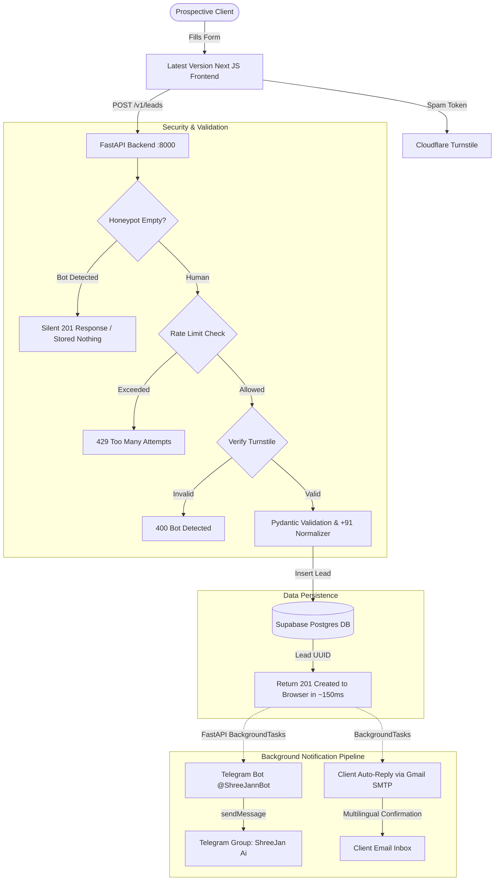

# SHREEJAN AI SOLUTIONS — Complete Backend Architecture & Setup Guide

This document explains the complete backend architecture, security mechanisms, database integration, and notification pipelines powering the **SHREEJAN AI SOLUTIONS** business web platform. Use this guide to understand and explain the system to team members and stakeholders.

---

## 1. High-Level Architecture Overview

The backend is built with **FastAPI (Python 3.12)** and operates as an asynchronous, high-throughput microservice decoupled from the **latest version Next JS** frontend.



---

## 2. The 5-Step Lead Lifecycle (How It Works)

### Step 1: User Submits Form on Frontend
- Client fills either the **Contact Form** (`/contact`) or **Forensic Website Audit Form** (`/audit`).
- Form collects: Full Name, Business Name, WhatsApp Number, Email Address, Project Type/Goals, Message, and DPDP Privacy Consent.
- Includes an invisible **Honeypot** input (`website`) positioned off-screen to trap automated bots.
- Generates a **Cloudflare Turnstile** token verifying human interaction without frustrating CAPTCHAs.

### Step 2: Strict Validation & Sanitization (`schemas.py`)
- Request payload hits `POST /v1/leads`.
- **String Trimming & Control Character Removal**: Strips null bytes and malicious control sequences.
- **Phone Number Normalizer**: Accepts spaces, dashes, brackets, `+91`, `91`, or leading `0`, validates against Indian telecom regex (`^[6-9]\d{9}$`), and stores in canonical format (`+91XXXXXXXXXX`).
- **Email Validation**: Validates RFC email format without blocking DNS lookups.
- **Consent Versioning**: Validates `consent: true` and logs legal version (`2026-11-v1`).

### Step 3: Multi-Layer Spam Defense
1. **Honeypot Filter**: If a spam bot fills the hidden `website` field, the server immediately returns a `201 Created` with a fake UUID and stores **nothing**, saving database resources and avoiding spam alerts.
2. **IP Rate Limiting**: In-memory sliding window allows maximum **3 submissions per IP per hour**. Exceeding returns `429 Too Many Requests` with a `Retry-After` header.
3. **Turnstile Verification**: Communicates with Cloudflare's `siteverify` endpoint (5-second timeout). If Cloudflare is down, it fails closed with `503 Service Unavailable` rather than letting unchecked traffic through.

### Step 4: Database Storage (Supabase Postgres)
- The lead is inserted into the `leads` table in **Supabase Postgres** (Mumbai `ap-south-1` region).
- Row flags initialized:
  - `status = 'new'`
  - `notified_team = false`
  - `auto_reply_sent = false`
- **Zero Client Waiting**: The backend immediately returns `201 Created` with `{ "id": "<uuid>", "message_key": "form.success" }` to the frontend. The user sees the success screen in milliseconds and never waits for emails or bot network dispatches.

### Step 5: Asynchronous Background Alerts (`BackgroundTasks`)
Once the response is delivered to the browser, FastAPI's non-blocking background workers trigger:
1. **Telegram Group Alert**:
   - Dispatches formatted alert to the **ShreeJan Ai** group via `@ShreeJannBot`:
     ```text
     New enquiry — {business}
     Name: {name}
     Phone: {phone}
     Email: {email}
     Service: {service} | Plan: {plan} | Budget: {budget}
     City: {city_state}
     Source: {utm_source}
     Message: {message}
     Lead id: {id}
     ```
   - On success, updates `notified_team = true` in Supabase.
2. **Client Auto-Reply Email**:
   - Dispatches branded confirmation email to client's email via Gmail SMTP (`aishreejan@gmail.com`).
   - Supports native English, Hindi, and Marathi templates matching user's selected language.
   - On success, updates `auto_reply_sent = true` in Supabase.

---

## 3. Directory Structure & Key Files

```
backend/
├── app/
│   ├── main.py            # FastAPI entry point, CORS middleware, routes & background worker dispatch
│   ├── config.py          # Pydantic BaseSettings loading configuration from .env
│   ├── schemas.py         # Strict Pydantic models, phone normalizer & input validators
│   ├── leads.py           # Database operations (Supabase SDK & REST fallback, in-memory store)
│   ├── db.py              # Supabase client singleton with graceful fallback
│   ├── turnstile.py       # Cloudflare Turnstile token validation via httpx
│   ├── ratelimit.py       # In-memory per-IP sliding window rate limiter
│   ├── privacy.py         # GET /v1/privacy-version endpoint
│   ├── retry.py           # Standalone CLI tool to re-dispatch pending notifications
│   └── notify/
│       ├── telegram.py    # Telegram Bot API message builder and HTTP dispatcher
│       ├── email.py       # Dual-engine email dispatch (Gmail SMTP & Resend HTTP API)
│       └── templates.py   # Localized auto-reply templates (en, hi, mr)
├── migrations/
│   └── 001_leads.sql      # Postgres migration (table, UUID, indexes, RLS & service_role grants)
├── tests/
│   ├── test_schemas.py    # Validation & phone normalizer test cases
│   ├── test_turnstile.py  # Turnstile mock tests & timeout checks
│   └── test_api.py        # End-to-end API integration tests
├── requirements.txt       # Pinned production Python dependencies
├── Dockerfile             # Multi-stage container build for deployment
├── README.md              # Backend technical documentation
└── .env                   # Local credentials (gitignored)
```

---

## 4. Environment Variables Reference

All credentials are kept in `backend/.env` (which is gitignored). Template file is `backend/.env.example`.

| Variable | Description | Current Value / Example |
| :--- | :--- | :--- |
| `SUPABASE_URL` | Supabase API endpoint | `https://htzbbitshztchhujyuij.supabase.co` |
| `SUPABASE_SERVICE_KEY` | Supabase Secret API key | `sb_secret_...` (or JWT `service_role`) |
| `TELEGRAM_BOT_TOKEN` | Bot API token from BotFather | `9269615490:AAGI4ImXl1ddDuJg...` |
| `TELEGRAM_CHAT_ID` | Telegram team group chat ID | `-5526935337` |
| `GMAIL_USER` | Official company Gmail address | `aishreejan@gmail.com` |
| `GMAIL_APP_PASSWORD` | 16-character Google App Password | `oxlr dvrq lrpc kakf` |
| `TEAM_INBOX` | Email where lead alerts route | `aishreejan@gmail.com` |
| `TEAM_EMAIL_ENABLED` | Toggle email alert to team | `false` (Alerts route via Telegram only) |
| `TURNSTILE_SECRET_KEY` | Cloudflare Turnstile secret key | `1x0000000000000000000000000000000AA` (local dummy) |
| `ALLOWED_ORIGINS` | Permitted frontend origins | `http://localhost:3000,http://127.0.0.1:3000` |
| `PRIVACY_VERSION` | Current legal consent version | `2026-11-v1` |

---

## 5. Database Schema & Row-Level Security

Located at [backend/migrations/001_leads.sql](file:///c:/Users/AKSHAY/Downloads/Projects/Shreejan1811/backend/migrations/001_leads.sql).

### Key Columns in `leads` Table:
- `id` (UUID, primary key, generated via `gen_random_uuid()`)
- `created_at` (TIMESTAMPTZ, default `now()`)
- `name`, `business`, `email`, `phone` (Normalized `+91XXXXXXXXXX`)
- `service`, `plan`, `budget`, `message`
- `preferred_language`, `site_language`
- `consent`, `consent_text_version`, `consent_at`
- `utm_source`, `utm_medium`, `utm_campaign`, `referrer`, `landing_path`
- `status` (`new` \| `contacted` \| `quoted` \| `won` \| `lost`)
- `notified_team` (BOOLEAN, default `false`)
- `auto_reply_sent` (BOOLEAN, default `false`)

### Security Features:
- **Row-Level Security (RLS)** is enabled with **no public policies**. Anonymous public users cannot read or write directly to Postgres.
- Only the backend's `service_role` has permissions to insert and update leads.

---

## 6. How to Run Locally

### 1. Prerequisites
- Python 3.12 installed
- Virtual environment created inside `/backend`:
  ```bash
  cd backend
  python -m venv .venv
  ```

### 2. Activate Virtual Environment
- **Windows (PowerShell)**:
  ```powershell
  .\.venv\Scripts\Activate.ps1
  ```
- **Linux/macOS**:
  ```bash
  source .venv/bin/activate
  ```

### 3. Install Dependencies
```bash
python -m pip install -r requirements.txt
```

### 4. Start Backend Server
```bash
python -m uvicorn app.main:app --host 0.0.0.0 --port 8000 --reload
```
Server health check: [http://localhost:8000/healthz](http://localhost:8000/healthz) → `{"ok": true}`

### 5. Run Test Suite
```bash
python -m pytest
```

---

## 7. Manual Retry Tool (`retry.py`)

If a network hiccup or temporary service outage occurs, notification flags remain `false` in Supabase. You can manually retry all pending notifications at any time:

```bash
cd backend
python -m app.retry
```
This queries all rows where `notified_team = false` or `auto_reply_sent = false` and re-dispatches them without creating duplicate rows.

---

## 8. Summary for Colleagues & Stakeholders

1. **Fast & Non-Blocking**: Clients experience instant submission confirmations without waiting for third-party email or chat APIs.
2. **Spam Proof**: Triple-barrier defense with Turnstile bot detection, hidden honeypots, and per-IP rate limiting.
3. **Multi-Channel Alerting**: Instant team notifications on Telegram + automated confirmation emails to prospective clients.
4. **Data Compliant**: Built strictly for Indian business operations adhering to India's DPDP Act with immutable consent timestamps and Row-Level Security.
